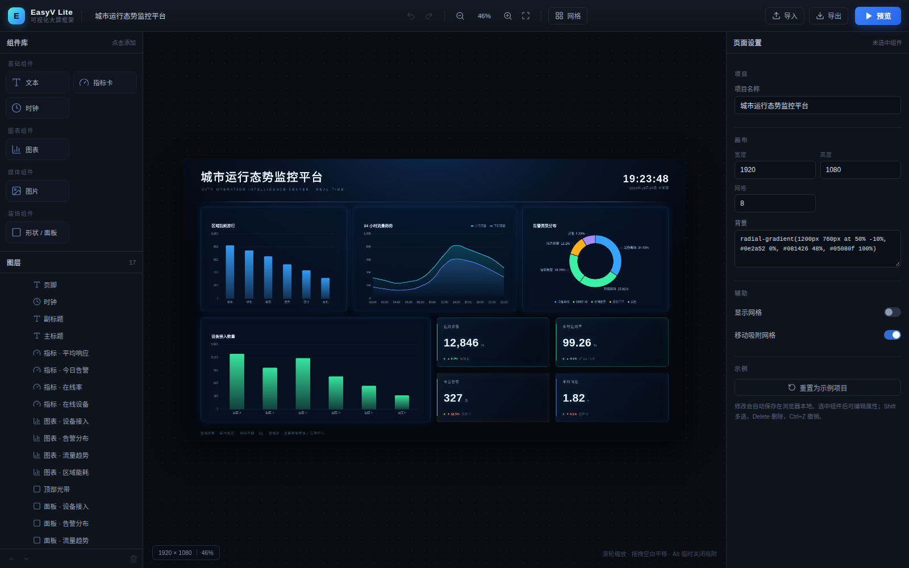
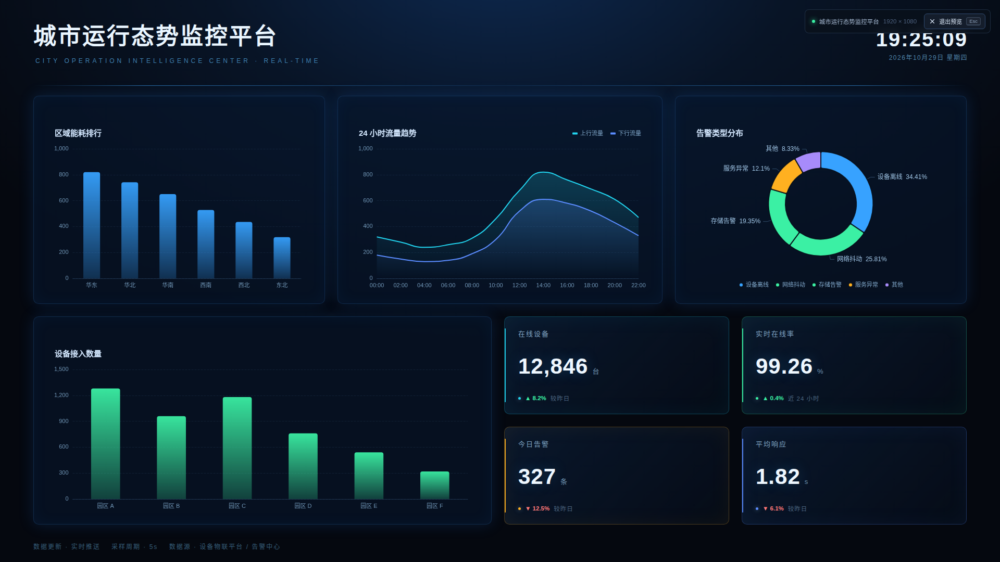

# EasyV Lite

一个 EasyV / DataV 风格的大屏可视化编辑器骨架：**拖拽搭建 → 属性配置 → 数据绑定 → 预览发布**。

它不是 EasyV 的完整复刻，而是一套可运行的“框架切片”：把文档模型、组件插件、画布交互、图层、属性面板、撤销重做、屏幕适配这些核心机制跑通，方便在此基础上继续扩展。

## 功能

- **画布**：1920×1080 设计稿，滚轮缩放、空白拖拽平移、适应画布、网格与吸附
- **编辑**：拖拽移动、八向缩放、Shift 多选、六种对齐、方向键微调、层级调整
- **组件**：文本、指标卡、时钟、形状 / 面板、ECharts 图表、图片
- **属性**：Schema 自动生成表单；位置 / 尺寸 / 透明度 / 组件私有属性
- **图表**：柱状图 / 折线图 / 饼图，支持静态 JSON 与 HTTP 轮询数据源
- **图层**：选择、显隐、锁定、上移 / 下移、删除
- **历史**：撤销 / 重做，拖拽合并为一步
- **持久化**：自动保存到 localStorage，支持 JSON 导入 / 导出
- **预览**：只读播放器，等比适应 / 铺满两种适配模式，Esc 退出

## 快速开始

环境要求：Node.js 18+。

~~~bash
npm install
npm run dev
~~~

打开 http://127.0.0.1:5173/ 。

生产构建：

~~~bash
npm run build
npm run preview
~~~

如果 npm 缓存目录存在权限问题，可以改用项目内缓存：

~~~bash
npm install --cache ./.npm-cache
~~~

## 快捷键

| 操作 | 快捷键 |
| --- | --- |
| 撤销 / 重做 | Ctrl/Cmd + Z / Ctrl/Cmd + Shift + Z |
| 复制 / 粘贴 / 复制副本 | Ctrl/Cmd + C / V / D |
| 删除 | Delete / Backspace |
| 微调位置 | 方向键（Shift 加速 10px） |
| 上移 / 下移一层 | ] / [ |
| 取消选择 / 退出预览 | Esc |
| 吸附临时关闭 | 拖拽时按住 Alt |

## 目录结构

~~~text
src/
  core/          文档模型、组件注册表、store、历史、存储
  components/    内置组件（每个组件一个文件）
  editor/        工具栏、组件库、画布、图层、属性面板
  runtime/       预览播放器
  App.tsx        布局、快捷键、自动保存
  styles.css     编辑器主题
ARCHITECTURE.md  架构、数据模型、后端、发布、路线图
scripts/         Playwright 截图 / 交互验证脚本（可选）
~~~

## 新增组件

实现一个 ComponentDef，声明默认尺寸、默认属性、属性 Schema 和 render，然后注册：

~~~tsx
// src/components/Gauge.tsx
export const gaugeComponent: ComponentDef = {
  type: 'gauge',
  name: '仪表盘',
  category: 'chart',
  icon: Gauge,
  defaultSize: { w: 320, h: 240 },
  defaultProps: { value: 68, unit: '%', color: '#22d3ee' },
  fields: [
    { key: 'value', label: '数值', type: 'number', min: 0, max: 100 },
    { key: 'unit', label: '单位', type: 'text' },
    { key: 'color', label: '颜色', type: 'color' },
  ],
  render: ({ node }) => <GaugeView node={node} />,
};
~~~

~~~ts
// src/components/index.ts
registerComponent(gaugeComponent);
~~~

注册后会自动出现在组件库、图层、属性面板和预览里，不需要修改编辑器代码。

## 这是什么 / 不是什么

**是**：一个可以跑、可以改、可以继续长成产品的编辑器内核原型。

**不是**：一个可以直接商用的 EasyV 替代品。当前版本刻意省略了后端、数据源管理、事件联动、发布、权限、模板、组件市场、多人协作。这些能力的实现顺序与取舍，见 [ARCHITECTURE.md](ARCHITECTURE.md)。

## 截图脚本（可选）

scripts/ 下的脚本使用 playwright-core 和本机 Chromium / Edge 做界面截图与交互回归，不属于运行依赖。需要时：

~~~bash
npm install --no-save playwright-core
node scripts/test.mjs
~~~

脚本中的 executablePath 需按本机浏览器路径调整。

## 技术栈

React 18 · TypeScript · Vite 5 · Zustand 5 · ECharts 5 · lucide-react
# easyr
